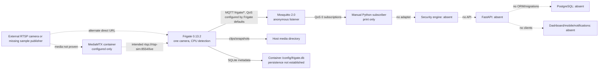
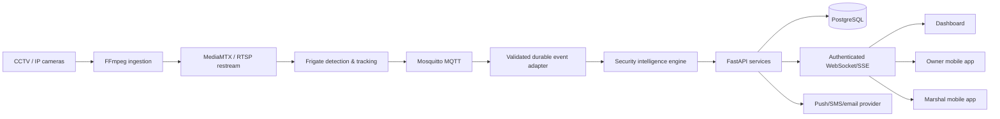
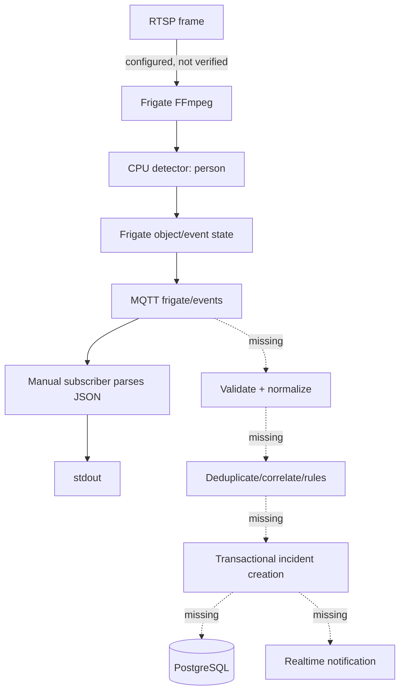
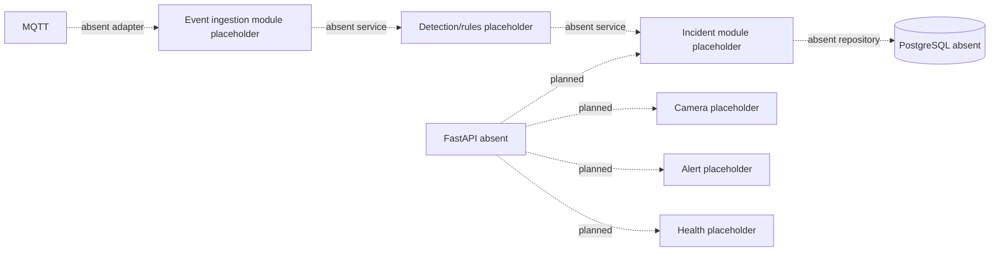
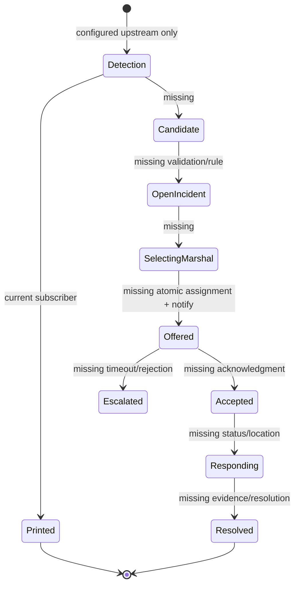

# System Architecture Audit

## Legend

Solid arrows/nodes are implemented or configured in this repository. Dashed arrows/nodes are intended but absent. “Configured” does not mean runtime-verified.

## Actual architecture

Evidence: Compose services and networking are in `ai-cctv/deployment/docker-compose.yml:3-49`; Frigate MQTT/camera/media settings are in `ai-cctv/frigate/config/frigate.yml:1-64`; the subscriber only prints in `ai-cctv/tests/test_mqtt_subscriber.py:31-41`.

## Intended architecture

The README's older intended flow is RTSP/ONVIF → motion gate → YOLO → ByteTrack → rule engine → alert/storage → dashboard/QRT (`README.md:56-88`, `:92-117`). The master audit context adds FastAPI/PostgreSQL and role-specific apps, but those are not repository implementations.

## Connection-by-connection verification

| Connection | Status | Protocol/data | Auth | Failure/recovery | Test evidence |
|---|---|---|---|---|---|
| Camera → MediaMTX | NOT IMPLEMENTED by default | Intended RTSP path `/live` | None configured | Container restart only; no publisher/source | None |
| Camera/MediaMTX → Frigate | CONFIGURED ONLY, likely misconfigured | FFmpeg reads RTSP; detect+record roles (`frigate.yml:32-44`) | Credentials may be embedded in URL; placeholder syntax is unsupported | Frigate controls FFmpeg internally; repository has no explicit offline policy | None; Docker unavailable |
| Frigate → recordings/snapshots | CONFIGURED ONLY | Local files; bounding-box snapshots (`frigate.yml:48-64`) | Filesystem/container boundary only | Retention configured; no capacity alarm/backup | None |
| Frigate → Mosquitto | CONFIGURED ONLY | MQTT host `mqtt`, prefix `frigate` (`frigate.yml:1-6`) | Anonymous; no TLS | Container restart; no broker health gate | None |
| Mosquitto → subscriber | IMPLEMENTED, UNVERIFIED | Topics `frigate/events`, `stats`, person topics; QoS 0 (`test_mqtt_subscriber.py:11-18`) | None | Paho loop; connection exception exits; no backoff (`:44-60`) | Syntax pass only |
| Subscriber → event adapter | NOT IMPLEMENTED | No normalized schema | N/A | N/A | None |
| Adapter → security engine | NOT IMPLEMENTED | No candidate/rule types | N/A | N/A | None |
| Security engine → FastAPI | NOT IMPLEMENTED | No interface | N/A | N/A | None |
| FastAPI → PostgreSQL | NOT IMPLEMENTED | Drivers declared only (`requirements.txt:5-7`) | No DB credentials/config | No transaction/retry behavior | None |
| API → dashboard/mobile | NOT IMPLEMENTED | No HTTP/WebSocket/SSE code | No auth/RBAC | No client error handling | None |
| API → notifications/dispatch | NOT IMPLEMENTED | No provider/client | No service credentials | No retries/delivery receipt | None |

All configured container calls use the default Compose network and service DNS. Processing would be asynchronous from Frigate to MQTT; the manual subscriber callbacks are synchronous and side-effect only. No processing acknowledgment exists at QoS 0.

## Camera-to-incident pipeline

An example Frigate event shape is documented at `ai-cctv/docs/phase1_setup.md:89-103`, but no fixture or executed test proves it. The only actual code attempts generic JSON decoding and prints the result (`test_mqtt_subscriber.py:31-41`).

## Backend service interactions

The named boxes reflect placeholder directories, not code: `ai-cctv/backend/app/*/.gitkeep:1`.

## Notification and marshal-dispatch workflow

## Intended-versus-implemented differences

- Frigate substitutes its own detector/tracker for the README's explicitly named YOLOv8/ByteTrack pipeline. No custom model, model file, ByteTrack code, motion-gate code, line-crossing, loitering, or rule engine exists (`README.md:121-141`; `frigate.yml:8-30`).
- MediaMTX is called a simulator, but no simulation process or media source exists (`docker-compose.yml:43-49`).
- FastAPI, PostgreSQL, dashboard, owner app, marshal app, dispatch, and notifications have no source.
- Frigate's short-lived object IDs do not establish persistent identity or face recognition. The README explicitly defers cross-camera re-identification and denies facial matching (`README.md:278`, `:326`).

## Single points of failure and critical risks

- One Mosquitto broker, one Frigate instance, one logical camera, and local host media are single points of failure (`docker-compose.yml:3-53`; `frigate.yml:32-64`).
- QoS 0 subscriptions and no durable application consumer mean delivery/processing is not guaranteed (`test_mqtt_subscriber.py:13-18`).
- No event ledger/idempotency key permits safe replay or duplicate suppression.
- Local-only storage has no backup, replication, encryption, evidence integrity, or capacity monitoring.
- Mutable/unlocked dependencies make builds non-reproducible (`requirements.txt:1-9`; Compose `:5`, `:45`).
- There is no trust boundary: exposed MQTT/Frigate/RTSP-related ports have no repository-defined gateway or network policy.

