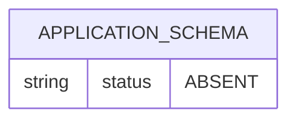
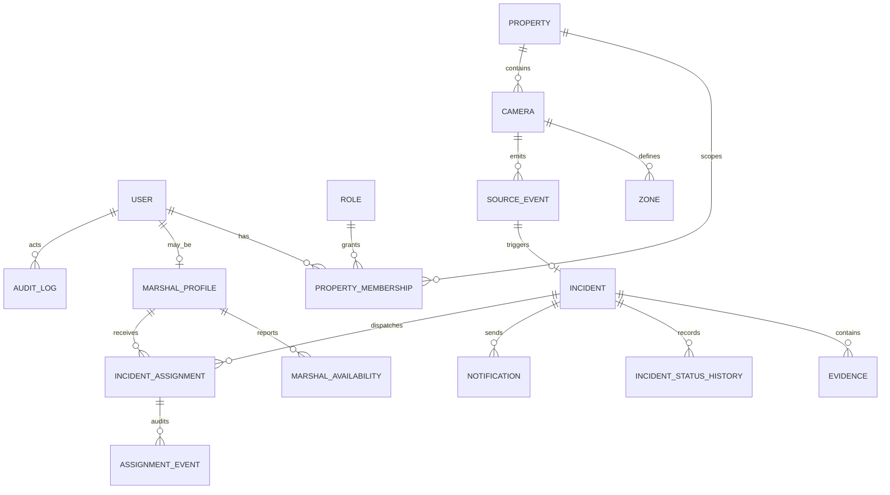

# Database and Persistence Audit

## Conclusion

SecurePulse has no application database implementation. PostgreSQL drivers and SQLAlchemy are declared (`ai-cctv/backend/requirements.txt:5-7`), but there is no connection configuration, ORM model, SQL, repository, migration, initialization, seed, transaction, constraint, foreign key, or index.

Frigate separately points its own internal metadata store at SQLite path `/config/frigate.db` (`ai-cctv/frigate/config/frigate.yml:13-14`). That third-party database is not the SecurePulse domain database, and its schema is neither defined nor migrated in this repository.

## Actual persisted data

| Store | Purpose | Persistence declaration | Risk |
|---|---|---|---|
| Mosquitto named volumes | Broker persistence/logging | `mosquitto_data`, `mosquitto_log` (`docker-compose.yml:10-13`, `:51-53`) | No backup/restore, encryption, retention, or health policy |
| Frigate media bind mount | Clips/snapshots | `../frigate/media:/media/frigate` (`docker-compose.yml:28-35`) | Local disk only; no capacity/integrity/access policy |
| Frigate SQLite | Upstream tracked-object/recording metadata | `/config/frigate.db` (`frigate.yml:13-14`) | `/config` directory is not mounted as a persistent volume; only one config file is bound (`docker-compose.yml:30`) |
| PostgreSQL | Intended application records | No service/URL/schema/migration | Absent |

## Application schema report

There are **zero application tables** to report. Therefore there are no application primary keys, foreign keys, constraints, relationships, or indexes.

| Required concept | Table found? | Evidence |
|---|---|---|
| Users / roles | No | No model or migration |
| Properties / memberships | No | No model or migration |
| Cameras / zones | No | Frigate YAML only, not application data |
| Source/security events | No | Subscriber prints only |
| Incidents / evidence | No | No model; media files unmanaged by application |
| Notifications | No | No provider or table |
| Marshals / availability / location | No | No source |
| Incident assignments / acknowledgments | No | No source |
| Escalation / status history | No | No source |
| Audit logs | No | No source |

## Actual ER diagram

Frigate's internal SQLite schema is deliberately excluded: it belongs to the pinned third-party image and is not represented by repository migrations. Treating it as a stable SecurePulse domain contract would couple the application to an upstream implementation detail.

## Minimum proposed domain model

The following is a gap model, not an implemented schema:

## Required integrity and concurrency design

- Tenant isolation: every property-owned row must carry or derive a property ID; authorization tests must prove cross-property reads/writes fail.
- Event idempotency: unique `(source_system, source_event_id, event_revision/type)` or an equivalent durable receipt key prevents replay duplicates.
- Incident correlation: explicit uniqueness or transactional lock strategy must prevent two incidents from one eligible source event.
- Dispatch race safety: one active assignment constraint per incident/dispatch slot; marshal availability and offer creation must be locked or compare-and-swapped in one transaction.
- State integrity: status values and legal transitions should be constrained and recorded append-only in history.
- Evidence integrity: immutable metadata should include source, timestamps, content hash, storage key, retention/legal-hold status, and access log.
- Outbox pattern: incident/assignment transactions should write notification/realtime outbox rows atomically, then deliver asynchronously with retries.
- Temporal consistency: use UTC timestamps, database-generated creation time, and explicit event-observed/source time.

## Migration safety requirements

Adopt a migration tool (for example Alembic), transactional forward migrations, downgrade/roll-forward policy, schema-version checks on startup, and production backup/restore rehearsal. Constraints and indexes must be added with data backfills and lock impact assessed. None of these controls currently exists.

