# Emergency Response and Dispatch Audit

## Conclusion

There is no emergency-response implementation. The README describes a conceptual “Threat Detected → Event Classified → Alert Generated → Alert Routed → Security/QRT Notified → Rapid Response” sequence and explicitly says none of it is implemented (`README.md:145-165`). Repository-wide inspection confirms no later implementation.

## Capability inventory

| Capability | Status | Evidence / missing work |
|---|---|---|
| Incident eligibility | NOT IMPLEMENTED | No security rule/candidate/incident model |
| Property/perimeter mapping | NOT IMPLEMENTED | No property/geospatial schema; no zones configured |
| Marshal registration/verification | NOT IMPLEMENTED | No user/role/marshal source |
| Availability | NOT IMPLEMENTED | No model/API/realtime presence |
| Marshal location | NOT IMPLEMENTED | No consent/location ingestion/store |
| Service-area matching | NOT IMPLEMENTED | No geospatial data/query |
| Assignment creation | NOT IMPLEMENTED | No table/service/transaction |
| Accept/reject | NOT IMPLEMENTED | No authenticated command/state transition |
| Assignment timeout | NOT IMPLEMENTED | No scheduler/job/lease |
| Notification delivery | NOT IMPLEMENTED | No provider/outbox/receipt |
| Escalation | NOT IMPLEMENTED | No policy/timer/history |
| Multiple marshal coordination | NOT IMPLEMENTED | No assignment model |
| Incident closure | NOT IMPLEMENTED | No incident state machine |
| Response audit history | NOT IMPLEMENTED | No append-only history/audit log |

## Current incident state machine

No incident entity or state exists. The only observable state transition is MQTT message received → payload printed (`ai-cctv/tests/test_mqtt_subscriber.py:31-41`).

## Proposed minimum state machine

This design is future work and should be validated with product/operations stakeholders:

```mermaid
stateDiagram-v2
    [*] --> Open: eligible detection committed
    Open --> Dispatching: dispatch requested
    Dispatching --> Offered: marshal selected atomically
    Offered --> Accepted: authenticated marshal accepts before expiry
    Offered --> Dispatching: reject or timeout; append attempt
    Dispatching --> Escalated: no eligible marshal or retry policy exhausted
    Accepted --> EnRoute: marshal status update
    EnRoute --> OnScene: marshal arrival
    OnScene --> Resolved: resolution + evidence/notes
    Open --> Dismissed: authorized false-positive decision
    Accepted --> Cancelled: authorized cancellation
    Escalated --> Resolved: external/manual response recorded
    Resolved --> [*]
    Dismissed --> [*]
    Cancelled --> [*]
```

Every transition should store actor, timestamp, reason, prior/new state, correlation/request ID, and immutable audit record. Transition commands must be authorization-checked and idempotent.

## Principal race and security risks

These are design risks because the workflow is absent:

- **Duplicate assignment:** two workers select/offer the same marshal or incident unless the database enforces active-assignment uniqueness and transactional locking.
- **Unauthorized acknowledgment:** accepting by assignment ID alone enables IDOR; require authenticated marshal identity and ownership of an active, unexpired offer.
- **Timeout/accept race:** an accept at expiry can conflict with reassignment; use a database compare-and-swap on status and expiry.
- **Availability race:** presence/location can go stale between selection and offer; record freshness and reserve atomically.
- **Notification ambiguity:** sending a push is not delivery or acceptance. Persist outbox, provider receipt, device receipt where possible, and business acknowledgment separately.
- **Repeated detection:** duplicate MQTT events can dispatch multiple teams unless event receipt and incident correlation are durable.
- **Unauthorized closure/evidence access:** enforce role and property/assignment scopes on every command/read.

## One end-to-end pilot scenario

Prioritize one scenario: a valid person event in one restricted zone creates exactly one incident; the nearest eligible on-duty marshal receives one offer; acceptance prevents reassignment; owner/dashboard receive status changes; marshal marks en-route/on-scene/resolved; all transitions and evidence references are retained.

Required components:

1. Camera/property/zone, source-event, incident, marshal, availability, assignment, status-history, notification-outbox, and audit schema.
2. Durable Frigate event adapter and one deterministic eligibility rule.
3. FastAPI auth/RBAC/property scoping and incident/dispatch command endpoints.
4. Atomic selector/offer transaction, expiring assignment lease, retry/escalation worker.
5. Push/realtime provider adapter with delivery telemetry.
6. Minimal dashboard/owner view and marshal accept/status UI.
7. Integration tests for duplicates, concurrent accept/timeout, unavailable marshal, provider failure, and unauthorized actors.

Advanced route optimization, multi-marshal tactics, and cross-camera identity should wait until this scenario is proven.

