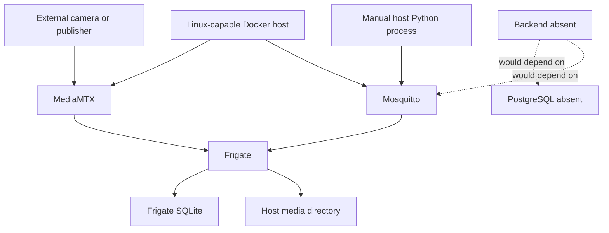

# Security, Privacy, Infrastructure, and Deployment Audit

## Security findings

No real credentials are reproduced below. Findings distinguish confirmed repository configuration from runtime-dependent risk.

| Severity | Finding | Affected evidence | Impact | Mitigation |
|---|---|---|---|---|
| Critical | MQTT permits anonymous clients on all interfaces and is host-published. | `mosquitto.conf:1-2`; `docker-compose.yml:8-13` | Reachable attackers can observe/spoof detection traffic, trigger downstream incidents once built, or leak telemetry. | Disable anonymous access; per-service credentials/certificates, TLS, least-privilege topic ACLs, private network exposure, rotation, negative auth tests. |
| High | Frigate is privileged and maps all USB devices despite CPU detector config. | Compose `:18-22`; Frigate `:8-11` | A container compromise has unnecessarily broad host/device access. | Remove `privileged`; map only required device; use non-root/read-only/capability restrictions. |
| High | Service ports are directly exposed without repository-defined reverse proxy/auth/network controls. | Compose `:8-9`, `:23-27`, `:48-49` | Frigate UI/API, MQTT, RTSP/WebRTC surfaces may be reachable from untrusted networks. | Bind locally/private network, firewall, authenticated gateway, TLS, and avoid publishing internal-only ports. Verify upstream version auth behavior. |
| High | Default stream topology cannot start cleanly because two services claim host port 8554. | Compose `:25`, `:49` | Phase 1 deployment failure. | Publish only one external RTSP port or use distinct host ports; use service DNS internally; test clean-machine startup. |
| High | Camera URL substitution is not valid for the mounted Frigate config. | `frigate.yml:36`; Compose `:36-39` | No video ingestion; credentials may be handled inconsistently. | Use supported `{FRIGATE_*}` substitution or generated config/secret mechanism; validate config in CI. |
| High | No application auth, authorization, tenant isolation, or evidence access control exists. | Backend placeholders; no source | Any future API bolted onto current scaffold risks cross-property/role data exposure. | Build identity, short-lived sessions/tokens, role+property policy, deny-by-default resource checks, audit and security tests before client rollout. |
| Medium | A weak fallback password is placed in Frigate environment but not correctly used. | Compose `:37`; no matching config reference | Encourages insecure defaults and false confidence. | No default secret; require secret injection; fail startup if absent; never log it. |
| Medium | MQTT/RTSP transport encryption is not configured. | `mosquitto.conf:1-5`; RTSP path at `frigate.yml:36` | Credentials/video/events can be intercepted on an untrusted network. | TLS/mTLS or isolated trusted network/VPN; document certificates and rotation. |
| Medium | Mutable/unlocked images and Python ranges reduce supply-chain reproducibility. | MediaMTX `latest` at Compose `:45`; `requirements.txt:1-9` | Unexpected breaking/vulnerable versions. | Pin image digests and exact dependency lock hashes; automated vulnerability/SBOM scanning. |
| Medium | No `.gitignore` protects local media/config/secrets. | Repository inventory; tracked media `.gitkeep` | Operators may accidentally commit footage, `.env`, databases, or credentials. | Add narrowly scoped ignores, pre-commit secret scanning, media outside source tree, documented secret store. |
| Medium | No rate limiting, input validation boundary, audit trail, retention governance, or security monitoring exists. | No backend; media retention only at `frigate.yml:48-64` | Abuse, weak forensics, and privacy noncompliance. | Implement controls with product/legal retention requirements and test them. |

The MQTT and privilege findings are confirmed configuration weaknesses. Actual external reachability depends on host firewall/network and must be verified at deployment.

## Application security control coverage

Because no application exists, several vulnerability classes are **not currently testable**, not “safe.” Password hashing, JWT/session lifecycle, CORS policy, API input/response validation, SQL injection resistance, IDOR/property isolation, WebSocket/SSE authentication, evidence authorization, sensitive-log redaction, and application audit trails are all absent. SQLAlchemy/Pydantic/FastAPI dependency declarations (`ai-cctv/backend/requirements.txt:1-7`) do not supply these controls automatically. Each must receive positive and negative tests when its endpoint or persistence layer is introduced.

## Privacy assessment

- The README states local processing, local storage, configurable retention, and no face matching as goals (`README.md:271-280`). Only local media mounting and Frigate retention are configured; there is no deletion audit, legal hold, consent, subject-access process, encryption, or access log.
- Bounding-box snapshots and recordings can contain sensitive personal data (`frigate.yml:48-64`). Their filesystem access inherits host permissions; no application authorization mediates access.
- Persistent biometric identity is not implemented, which reduces one class of risk. Object tracking still creates surveillance metadata and requires lawful-purpose, signage/notice, minimization, and jurisdiction-specific review.
- Marshal location would introduce employee/location privacy risk but is not implemented. Future design needs consent, precision/freshness limits, retention, access logging, and off-duty exclusion.

## Deployment topology and dependencies

Configured startup expresses only Frigate → MQTT ordering (`docker-compose.yml:40-41`). `depends_on` does not establish broker readiness, and MediaMTX is not a declared dependency. No service has a health check.

## Infrastructure inventory

| Area | Current state |
|---|---|
| Container networking | Default Compose network/service names; no segmentation |
| Ports | MQTT 1883, Frigate 5000/8554/8555 TCP+UDP, MediaMTX 8554 |
| Volumes | Broker data/log named volumes; media host bind; config file bind; tmpfs cache |
| Restart | `unless-stopped` for all three services |
| Health/readiness | None |
| Resource limits | Frigate shared memory/tmpfs only; no CPU/memory limits |
| Logging | Mosquitto stdout; no aggregation/rotation/metrics/alerts |
| Monitoring | None |
| Backups | None |
| Database hosting | No PostgreSQL service/external config |
| Backend/frontend hosting | None |
| CI/CD | None |
| IaC/orchestration | Compose only; no production environment definition |

## Clean-machine deployability

**Not currently deployable as a functioning Phase 1 system from a clean machine.** Even with Docker, static blockers include port collision, absent sample stream publisher, and invalid/unsupported stream placeholder. Images also require network pulls, and the setup guide asks users to install Paho manually (`phase1_setup.md:80-87`) instead of providing a reproducible test container/environment.

The audit host is Windows with Python 3.14.7 and no Docker. Compose assumes Linux paths/devices (`docker-compose.yml:21-22`, `:29`), so runtime checks were blocked and Windows support is unverified.

## Prototype versus production

This is local prototype configuration. Production requires isolated networks, secrets management, TLS, least-privilege containers, pinned images, health/readiness, redundancy, durable PostgreSQL, queue/outbox semantics, observability/SLOs, backup/restore, capacity planning, evidence retention/access governance, automated delivery, and an incident-response runbook.

